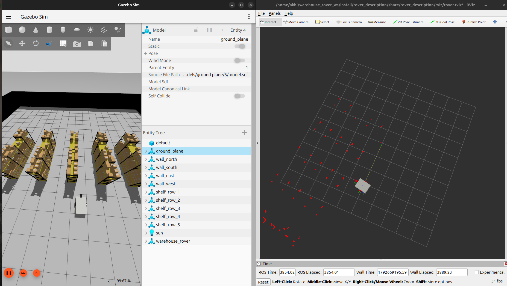
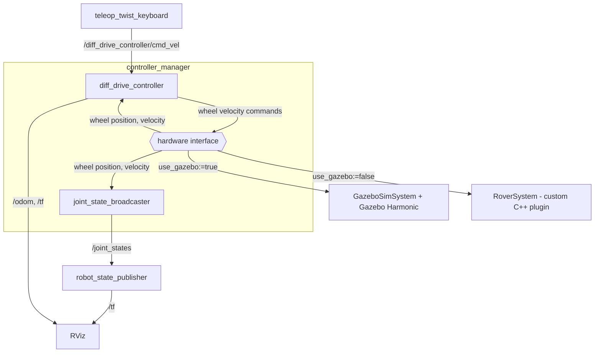
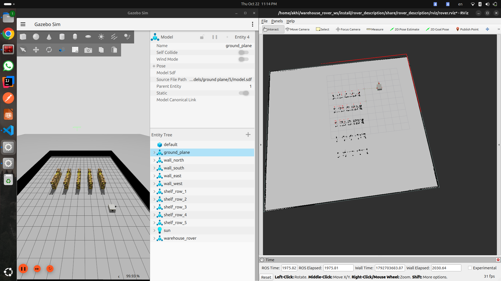

# Warehouse Rover

A simulated differential-drive warehouse robot built with **ROS 2 Jazzy** and **Gazebo Harmonic**.
The robot runs either in Gazebo or on a custom `ros2_control` hardware interface written in C++,
using the same controllers in both cases with no changes.



## Features
- Modular URDF/xacro model of a `differential-drive` AMR (2 drive wheels, 4 casters), sized from real warehouse AMR specs
- Custom Gazebo Harmonic warehouse world (20×20 m, 5 shelf rows, 1.5 m aisles)
- Simulated 2D lidar, IMU and RGB camera, bridged to ROS 2 with `ros_gz_bridge`
- ros2_control with `diff_drive_controller` and `joint_state_broadcaster`
- Custom C++ hardware interface (`RoverSystem`), loaded as a `ros2_control` plugin
- Two launch modes: Gazebo simulation, or the custom hardware interface without Gazebo
- Keyboard teleoperation
- SLAM mapping of the warehouse with slam_toolbox

## Architecture

| Package | Description |
|---|---|
| `rover_description` | Robot model and launch files |
| `rover_hardware` | Custom C++ ros2_control hardware interface (RoverSystem)




## SLAM mapping

The rover builds a 2D occupancy grid map of the warehouse with slam_toolbox (online async mode), using the lidar `/scan` and the wheel odometry from `diff_drive_controller`.



Run in three terminals:

```bash
ros2 launch rover_description gazebo.launch.py
ros2 launch rover_description slam.launch.py
ros2 run teleop_twist_keyboard teleop_twist_keyboard --ros-args -p stamped:=true -r /cmd_vel:=/diff_drive_controller/cmd_vel
```

Save the map:

```bash
ros2 run nav2_map_server map_saver_cli -f src/rover_description/maps/warehouse
```

Notes:

- Map resolution 0.05 m, lidar range 0.05 to 9.0 m (`config/slam_params.yaml`).
- Saved map: `maps/warehouse.pgm` and `maps/warehouse.yaml` (20 x 20 m, 400 x 400 cells).
- Known limitation: the open pallet racks appear as broken segments, because the 2D lidar only sees the uprights and boxes at its scan height (0.47 m). Keepout zones are planned for navigation.